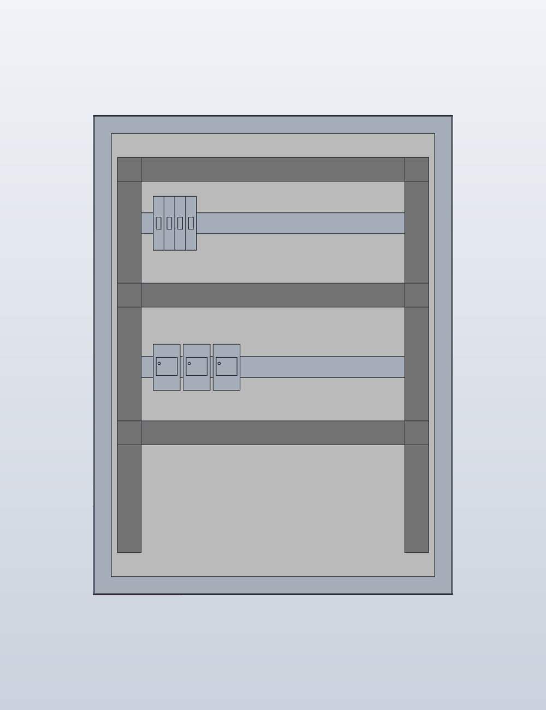
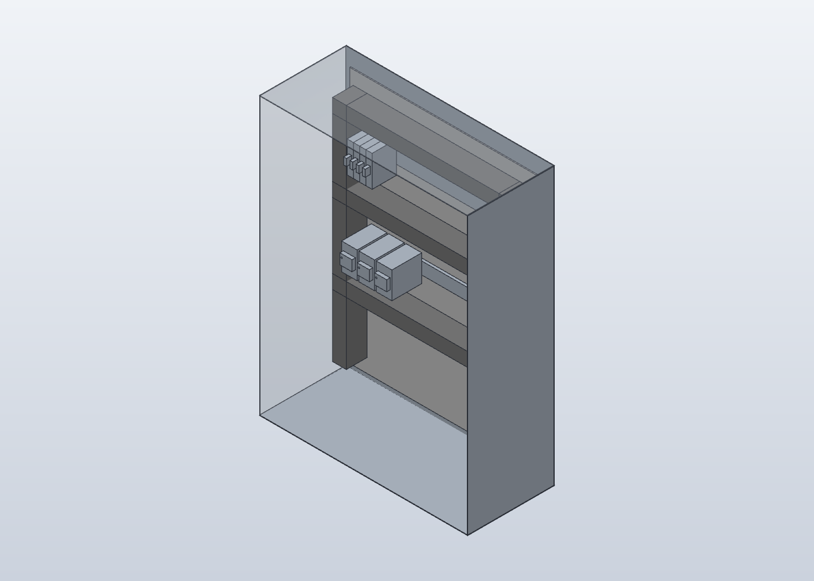
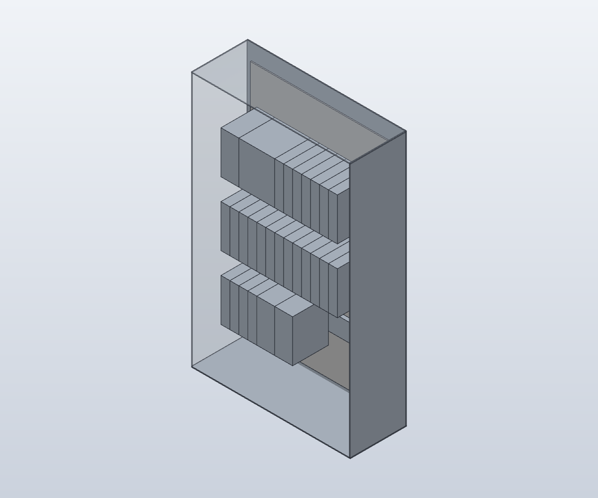

# Prueba de concepto: pasarela KatieCAD → SolidCraft

Montaje neutro (`montaje.json`) → script de `solidcraft-cli` → armario 3D (`.sc` + `.step`).
Resultado y conclusiones: `docs/CONTINUACION.md`, apartado 4.5.

Requisito: SolidCraft instalado (probado con `solidcraft-cli 0.41.0` en `D:\SolidCraft`).

```bash
cd tools/solidcraft_poc
# 1. Piezas de fabricante de prueba (cajas sencillas exportadas a STEP en lib/)
mkdir lib
solidcraft-cli run make_contactor.json --quiet
solidcraft-cli run make_mcb.json --quiet
# 2. Montaje -> script -> armario 3D
python montaje_a_solidcraft.py montaje.json cuadro_script.json
solidcraft-cli run cuadro_script.json --save cuadro.sc --out cuadro.step
# 3. Lista de materiales (bom.csv) y vista frontal en DXF (frente.dxf)
solidcraft-cli run post.json --in cuadro.sc
# 4. Imágenes
solidcraft-cli snapshot --in cuadro.sc --out iso.png --view iso --no-grid
```

Convención de ejes (la de `model/schrank.py`): Z arriba, frente hacia −Y, placa al fondo.
Cada STEP de equipo: ancho en X, alto en Z, fondo hacia −Y, trasera en y = 0.

 

## Desde un proyecto QElectroTech (`.qet`)

`qet_a_montaje.py` lee los equipos del esquema (etiqueta, fabricante, referencia,
descripción), busca medidas y STEP en un catálogo por referencia (`catalogo_hager.json`) y los
reparte por los carriles del cofre que también se reconoce por su referencia (`rol: armario`).
Sale el mismo `montaje.json` neutro, así que el resto de la pasarela no cambia.

```bash
python qet_a_montaje.py "C:/Program Files/QElectroTech/examples/tableau_domestique.qet" catalogo_hager.json montaje_qet.json
python montaje_a_solidcraft.py montaje_qet.json qet_script.json
solidcraft-cli run qet_script.json --save qet_cuadro.sc --out qet_cuadro.step
```

Equipos sin STEP en el catálogo se dibujan como cajas con sus medidas; sin catálogo, caja de
1 módulo. Los que no tienen referencia no se montan (se avisa). Solo `.qet`; un `.qetz` hay que
guardarlo antes como `.qet` en QElectroTech.


